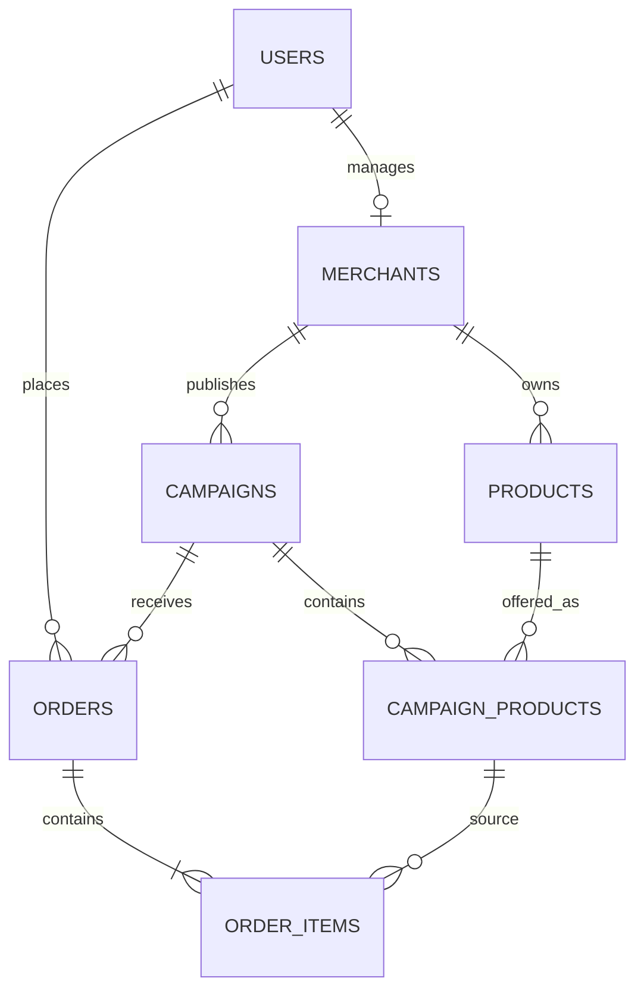

# Modelo de datos conceptual

Este documento describe el modelo inicial, no un esquema Drizzle definitivo ni migraciones. Se contemplan siete entidades principales.

## Entidades

### 1. users

Identidad de las personas que utilizan la aplicación. Distingue los perfiles básicos de comerciante y comprador. Los detalles exactos de autenticación y registro se concretarán durante V0.1.

### 2. merchants

Perfil del comercio gestionado por un usuario comerciante. Cada comerciante tiene un único comercio.

### 3. products

Catálogo permanente de productos de un comercio. Los datos concretos del producto podrán actualizarse sin reescribir pedidos anteriores.

### 4. campaigns

Campañas pertenecientes a un comercio. Un comercio puede tener varias campañas históricas, pero solo una activa al mismo tiempo.

### 5. campaign_products

Relación entre campaña y productos seleccionados del catálogo. Contiene el precio específico al que se ofrece el producto en esa campaña.

### 6. orders

Pedido creado por un comprador en una campaña. La campaña determina el comercio al que pertenece.

### 7. order_items

Líneas del pedido. Conservan la cantidad, el nombre del producto y el precio unitario aplicados en el momento de confirmar el pedido.

## Relaciones

## Restricciones de negocio

- Un usuario comerciante tiene como máximo un registro en `merchants`.
- Un comercio posee sus propios productos y campañas.
- Un producto solo puede incluirse en campañas del mismo comercio.
- Un comercio no puede tener más de una campaña activa simultáneamente.
- Un pedido pertenece a un comprador y a una sola campaña.
- El comercio del pedido se obtiene de la campaña; no debe poder contradecirse mediante un identificador de comercio independiente.
- Las líneas del pedido conservan snapshots del nombre y precio unitario.
- Los cambios futuros de catálogo o precio de campaña no alteran snapshots históricos.

## Integridad y consistencia

La unicidad de campaña activa debe protegerse en PostgreSQL mediante una restricción o índice único parcial adecuado al modelo final, además de validación y transacción en el servidor.

La confirmación de un pedido debe comprobar la campaña activa y los precios vigentes y guardar pedido y líneas de forma atómica.

## Campos todavía no definidos

No se fijan aquí campos de dirección, imagen, inventario, horarios, puntos de recogida, ventanas de campaña, estados concretos de pedido ni campos de facturación. Se concretarán solo cuando exista una necesidad aprobada.
