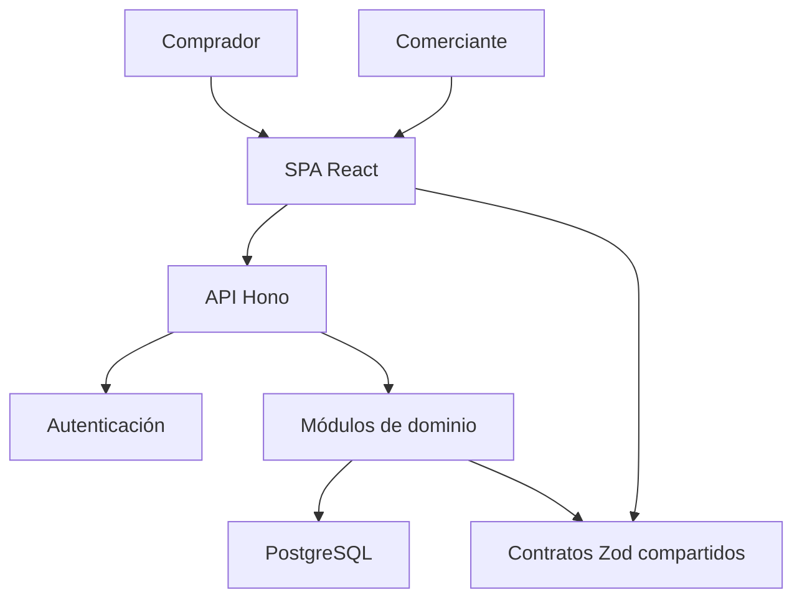

# Visión general de la arquitectura

## Enfoque

Aplicación web SaaS construida como monolito modular en un monorepo pnpm. El repositorio contiene una SPA React, una API Node.js + Hono y un paquete pequeño de contratos compartidos.

No se utilizarán microservicios ni se separarán las dos experiencias de usuario en aplicaciones frontend distintas.

## Componentes

- `apps/web`: SPA React con rutas y experiencias para comerciante y comprador.
- `apps/api`: API Hono organizada por módulos de dominio.
- `packages/contracts`: esquemas Zod y tipos compartidos entre frontend y backend.
- PostgreSQL: persistencia relacional.
- Drizzle ORM: acceso tipado a PostgreSQL y gestión de esquema.
- Better Auth: autenticación.

## Diagrama lógico

## Límites

- El frontend no accede directamente a PostgreSQL.
- Los handlers HTTP no contienen reglas de negocio complejas.
- Los módulos de dominio no dependen de componentes React.
- Las validaciones se realizan en el servidor, aunque también existan validaciones de experiencia en el frontend.
- Los contratos se comparten solo cuando representan una interfaz real entre aplicaciones.
- No se crea una capa genérica o un paquete adicional sin necesidad demostrada.

## Reglas de dominio que condicionan la arquitectura

- Cada comerciante gestiona un único comercio.
- Solo puede existir una campaña activa por comercio.
- Cada pedido pertenece a una sola campaña y comercio.
- Las líneas del pedido almacenan snapshots históricos del nombre y precio del producto.

## Decisiones pendientes

No se fijan todavía proveedor de alojamiento, topología de despliegue, almacenamiento de imágenes, política de acceso público, modalidad de recogida ni estrategia de internacionalización. Las preguntas de producto están registradas en [cuestiones abiertas](../product/open-questions.md).
